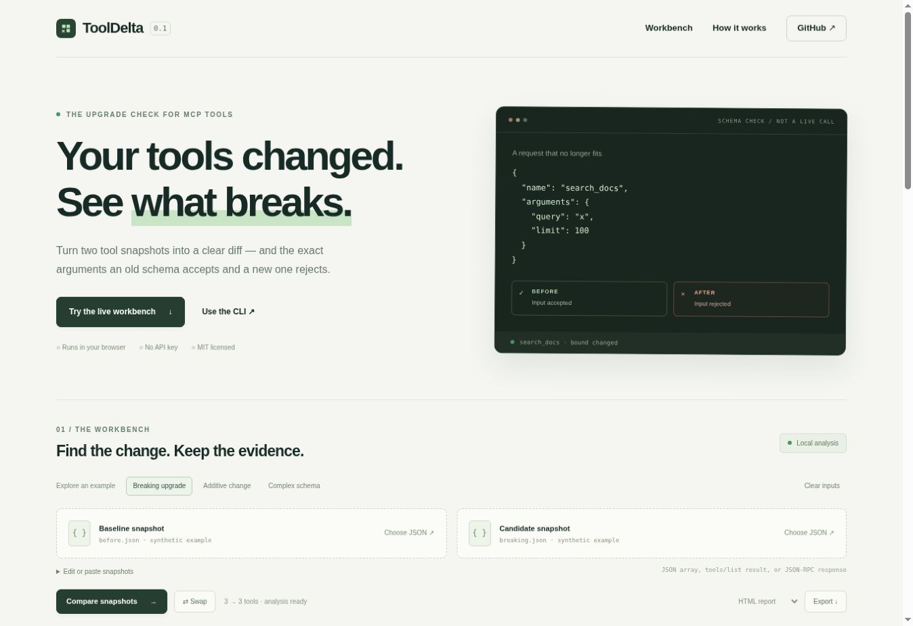
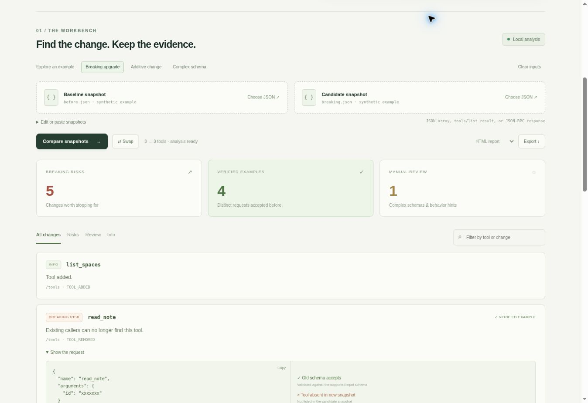

# ToolDelta

**直接展示：哪一份 MCP 工具调用参数，会被升级后的输入 Schema 拒绝。**

[在线工作台](https://lashonbakker-crypto.github.io/tooldelta/) · [English](README.md) · [实现说明](DESIGN.md)

[](https://lashonbakker-crypto.github.io/tooldelta/)

升级 MCP 服务后，只增加一个必填参数或收紧一个取值范围，就可能让原本正常的 Agent 调用失败。ToolDelta 比较两份保存的工具定义，提供差异、风险说明，以及“旧输入规则接受、新输入规则拒绝”的具体参数示例。浏览器与 CLI 使用同一核心，不连接服务、不执行工具，也不调用模型。

附带的自编教学样本产生 5 条风险、4 份不同的已验证请求、1 条人工复核项。一个请求可能同时触及多项变化。这里验证的是工具输入 Schema，不是实际服务返回。

<details>
<summary>展开查看真实分析结果</summary>



截图来自已部署的工作台，使用仓库附带的自编快照。
</details>

## 立即运行

Node.js 20+，运行 CLI 无需安装依赖：

```bash
git clone https://github.com/lashonbakker-crypto/tooldelta.git
cd tooldelta
node tooldelta.mjs before.json after.json
```

示例因检测到风险返回 1。只探索而不阻断时，添加 `--fail-on none`。导出独立 HTML 报告：

```bash
node tooldelta.mjs before.json after.json --format html --fail-on none > upgrade-report.html
```

输出必须使用新的文件路径，不能重定向到输入文件。Shell 会先清空重定向目标。报告可能包含 Schema 的原始值与生成参数，分享前应检查。

打开在线工作台即可体验三个场景、选择本机 JSON、筛选差异并导出 HTML / JSON / Markdown。文件内容仅在浏览器内存中处理，刷新清空；托管页面仍需从 GitHub Pages 加载程序本身，没有数据上传或统计请求。本地预览可运行 `python -m http.server 8080 --bind 127.0.0.1` 后打开 `http://127.0.0.1:8080`。

## 输入与退出码

支持工具数组、`{"tools":[...]}`、`{"result":{"tools":[...]}}`。两份快照应属于同一个服务和工具范围。自行使用已有可信客户端获取完整工具列表；先合并分页，非空 `nextCursor` 会报错，避免把未读到的工具误判为删除。

| 参数 / 状态 | 行为 |
| --- | --- |
| `--format text/json/markdown/html` | 默认 text |
| `--fail-on risk/review/none` | 默认 risk；review 同时阻断人工复核项 |
| 退出 0 | 没有被当前策略阻断的发现，不代表完整兼容 |
| 退出 1 | 命中了阻断策略 |
| 退出 2 | 输入非法 / 不完整或分析失败 |

## 证据与边界

已验证示例必须通过完整的已支持旧 Schema，并不通过完整的已支持新 Schema，同时触及相关变化；工具删除则检查其从新快照消失。测试会用独立 Ajv 2020-12 校验器复核生成示例。

支持类型、整数与普通数值、对象属性与必填项、额外属性、enum/const、数值范围、按 Unicode 码点计算的字符串长度、数组 items/长度/唯一性、对象属性数量。遇到 `$ref`、组合规则、条件、pattern、format、自定义方言等未知关键字，会禁止该工具的“已验证”标记并提示人工复核，不会抓取引用或执行输入里的正则表达式。未变动的复杂 Schema 可显示为“未变”，这不验证其本身有效性。

它是保守的静态差异检查，不是完整的 JSON Schema 兼容性求解器，也不证明服务实现或安全性。生成搜索有上限，没找到示例不等于没有问题。输出 Schema、描述和提示性权限标注的变化进入人工复核；这些标注并不是强制权限。

每份输入上限 2 MiB、200 个工具；JSON 深度 40、Schema 深度 32；分析有 250000 次操作和 1000 条发现的上限，浏览器任务五秒终止。重复键、重复工具名、非有限数字或超出 JavaScript 安全整数范围的值会报错；其他数值使用 IEEE-754 表示。

开发测试使用 `npm ci && npm test`；Ajv 仅作为固定版本的开发验证依赖，运行时核心无需第三方包。实际平台与页面检查结果见 [VALIDATION.md](VALIDATION.md)。

同类工具包括 [mcpdiff](https://github.com/samlader/mcpdiff)、[mcpdrift](https://github.com/gdworks-studio/mcpdrift)、[Cisco MCP Toolkit Contract](https://github.com/cisco-open/mcptoolkit-contract)。本项目独立实现，侧重浏览器工作台、具体失败请求和浏览器 / CLI 共用的静态分析；没有实现它们的实时抓取和完整服务测试。

欢迎提交最小可复现的 Schema 对、边界案例与无障碍改进。只提交自编样本，不上传私人工具定义或聊天记录。MIT 开源；若解决了实际问题，欢迎 Star 收藏。
